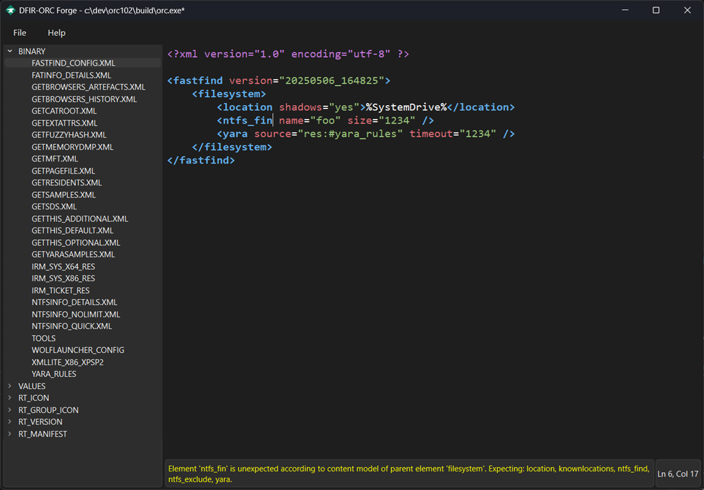

# DFIR-ORC Forge
[![LGPL licensed][img-license]](./LICENSE.txt)
[](https://github.com/DFIR-ORC/dfir-orc)
[](https://anssi-fr.github.io/README.en.html#project-categories)
[](https://documentation.ouvert.numerique.gouv.fr/les-parcours-de-documentation/ouvrir-un-projet-num%C3%A9rique/#niveau-ouverture)


## French Cybersecurity Agency (ANSSI)

*This project is managed by [ANSSI](https://cyber.gouv.fr/). To find out more, you can visit the [page](https://cyber.gouv.fr/enjeux-technologiques/open-source/) (in French) dedicated to ANSSI’s open-source strategy. You can also click on the badges above to learn more about their meaning.*

---

DFIR-ORC Forge is a companion tool for [DFIR-ORC](https://github.com/DFIR-ORC/dfir-orc),
the ANSSI forensic collection tool.

Create and modify DFIR-ORC configuration with syntactic validation based on XML schemas.  

## Current use cases
- Create, modify, and validate XML configuration files from scratch
  or from the built-in templates shipped with Forge.
- Create, modify, and validate Yara rules using compilation.
- Edit a configuration or Yara rule already embedded in a DFIR-ORC executable (via ToolEmbed) without prior extraction.

<p align="center">
  
</p>

While syntactic validation is performed, ToolEmbed still applies more advanced checks.
These could be integrated in a future version, including as a form-based GUI.

## Build
### Requirements
- Windows >=11 (English only as required by vcpkg)
- Visual Studio (with "Desktop development with C++")

### Getting the source
```
git clone --recursive https://github.com/dfir-orc/dfir-orc-forge.git
cd dfir-orc-forge
```

### Build a fully static release
```
cmake --preset forge-static
cmake --build --preset Static-MinSizeRel
```

### Build with Qt as shared dependency
```
cmake --preset forge -DQTDIR="C:/qt-sdk/6.8.3/msvc2022_64"
cmake --build --preset MinSizeRel
```

<p align="center">
    
</p>

## License

The contents of this repository are available under the [LGPL 2.1+ license](LICENSE.txt).  
The name DFIR ORC, the associated logo and the ANSSI logo belong to ANSSI, no use is permitted without express approval.

---

Le contenu de ce dépôt est disponible sous licence LGPL 2.1+, tel qu'indiqué [ici](LICENSE.txt).  
Le nom DFIR ORC, le logo associé et le logo de l'ANSSI appartiennent à l'ANSSI, aucun usage n'est permis sans autorisation expresse.

---

[img-license]: https://img.shields.io/github/license/DFIR-ORC/dfir-orc-forge
